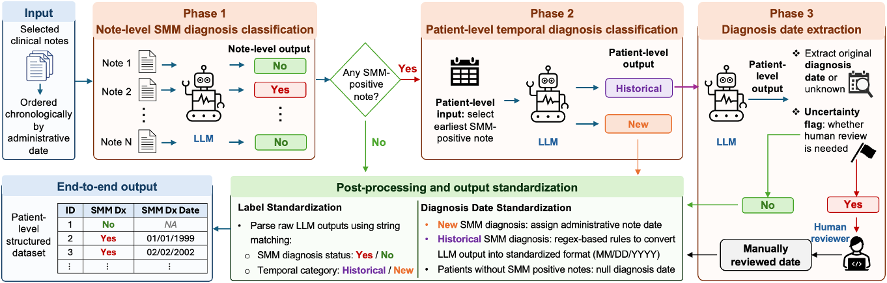

# Publish SMMnlp on GitHub

The repository's main page displays the root `README.md`. That file already
contains the project overview, workflow figure, installation commands, input
requirements, folder guide, and links to the detailed documentation.

## Upload through the browser

1. Extract the project ZIP on your computer. Open the `SMMnlp_v2` folder.
2. Sign in to GitHub and open <https://github.com/new>.
3. Choose a repository name, such as `SMMnlp-v2`. Select Public if you want
   interviewers to access it without an invitation, or Private if you want to
   control access.
4. Leave the README, license, and `.gitignore` initialization options unselected
   for this upload. The project folder includes a README and `.gitignore`.
5. Create the repository. On the empty repository page, click **uploading an
   existing file**. For a repository that already contains files, use
   **Add file → Upload files**.
6. Drag the files and subfolders **inside** `SMMnlp_v2` into the upload area.
   Keep `README.md`, `demo.py`, `run_pipeline.py`, `smmnlp/`, and `assets/` directly
   at the repository's top level. On a Mac, Command–Shift–Period shows hidden
   files so you can include `.gitignore`.
7. Enter a commit message such as `Add SMMnlp application and workflow figure`,
   then commit the upload using the action offered by GitHub.
8. Open the repository's **Code** tab. The README and figure should appear
   below the file list. Confirm that `assets/smmnlp_workflow.png` opens too.

Use the freshly extracted project for this first upload. It contains a synthetic
data example. Clinical records, reviewed patient workbooks, model checkpoints,
and local credentials belong outside the public upload.

## Display the figure

The figure is included at:

```text
assets/smmnlp_workflow.png
```

The root README displays it using this Markdown:

```markdown

```

The image path is relative to the README. Keep that folder and filename when
uploading the project. GitHub resolves it on whichever branch is being viewed.

## Add information beside the project

Open the gear icon beside **About** on the repository's main page. Suggested
description:

> Local LLM pipeline for SMM diagnosis classification, temporal diagnosis labeling,
> and diagnosis date extraction from clinical notes.

Suggested topics: `clinical-nlp`, `large-language-models`, `clinical-informatics`,
`electronic-health-records`, and `information-extraction`.

To update the main project information later, open `README.md`, choose the edit
action, modify the Markdown, preview it, and commit your changes.

## Upload using Git instead

Create an empty GitHub repository first. Open a terminal in the extracted
`SMMnlp_v2` folder. Replace `YOUR_USERNAME` and `YOUR_REPOSITORY` with the values
from your repository:

```bash
git init
git add .
git status
git commit -m "Add SMMnlp application and workflow figure"
git branch -M main
git remote add origin https://github.com/YOUR_USERNAME/YOUR_REPOSITORY.git
git push -u origin main
```

Check the staged file list shown by `git status` before committing. Git applies
the included `.gitignore` rules when selecting files. Authenticate using your
configured GitHub credential manager, SSH setup, or GitHub's supported token
flow when prompted.

For later updates:

```bash
git add .
git status
git commit -m "Update project documentation"
git push
```

## GitHub documentation

- [About repository README files](https://docs.github.com/en/repositories/managing-your-repositorys-settings-and-features/customizing-your-repository/about-readmes)
- [Upload files to a repository](https://docs.github.com/en/repositories/working-with-files/managing-files/adding-a-file-to-a-repository)
- [Add locally hosted code to GitHub](https://docs.github.com/en/migrations/importing-source-code/using-the-command-line-to-import-source-code/adding-locally-hosted-code-to-github)
