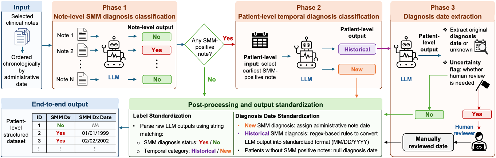

# SMMnlp

**LLM-based clinical phenotyping and diagnosis date extraction** · Version 2.0.0

A local LLM application for identifying smoldering multiple myeloma (SMM) in
clinical notes, distinguishing historical and new diagnoses, extracting diagnosis
dates, and evaluating predictions at the note and patient levels.

All application code, prompts, notebooks, tests, configuration, and entry-point
scripts are contained in this folder.

## Pipeline overview



*The workflow converts selected clinical notes into patient-level SMM diagnosis
labels and standardized diagnosis dates, with human review when requested by
the extraction stage.*

| Phase | Input | Task | Output |
|---|---|---|---|
| 1. Diagnosis classification | Selected clinical notes | Identify an explicitly documented SMM diagnosis in each note | Note-level Yes/No labels |
| 2. Temporal classification | Each positive patient's earliest positive note | Distinguish a historical diagnosis from a new diagnosis | Patient-level Historical/New labels |
| 3. Date extraction | Historical diagnosis notes | Extract the original SMM diagnosis date and identify cases requiring review | Diagnosis date or unknown, plus a review flag |

Post-processing standardizes labels and partial dates. New diagnoses use the
administrative note date; patients without positive notes receive a null
diagnosis date. Human-reviewed dates are supplied separately when needed.

The figure shows the complete study workflow. The command-line pipeline writes
the four intermediate prediction workbooks described below. Human review,
final date standardization, and reference-standard evaluation continue in the
notebook workflows.

## Quick start

Use Python 3.10 or later. Open a terminal in this folder and run:

```bash
python -m pip install -r requirements.txt
python demo.py
```

The demo uses synthetic notes and predefined model responses. It demonstrates
the workflow without downloading a model or requiring a GPU. The `smmnlp`
package sits beside `demo.py`, so an editable package installation is optional.
Keep the project folders together when moving or copying them.

## Workflow

1. Classify each note for an explicitly documented SMM diagnosis.
2. Select each positive patient's earliest positive note.
3. Classify that diagnosis as historical or new.
4. Extract the diagnosis date and human-review flag from historical notes.
5. Evaluate note-level, patient-level, date-presence, and date-difference results.

The pipeline loads one local model instance and reuses it across the inference
stages. Human-reviewed dates and reference labels are supplied separately.

## Folder guide

| Location | Contents |
|---|---|
| `demo.py` | Run the complete synthetic inference example |
| `run_pipeline.py` | Run a local LLM task or the complete inference pipeline |
| `smmnlp/` | Model loading, inference, parsing, preprocessing, metrics, and file I/O |
| `smmnlp/prompt_templates/` | Diagnosis, history, and date-extraction prompts |
| `notebooks/00_cohort/` | Cohort construction and patient-level data splitting |
| `notebooks/01_diagnosis/` | Note classification and diagnosis evaluation |
| `notebooks/02_history/` | First-positive note preparation and history classification |
| `notebooks/03_dates/` | Date extraction, review flags, and date evaluation |
| `notebooks/04_pipeline/` | Patient-level inference and reference-standard evaluation |
| `notebooks/05_external/` | External diagnosis and date evaluation |
| `config/` | Study exclusion configuration |
| `data/` | Input schemas and a synthetic example |
| `models/` | Local checkpoint location instructions |
| `results/` | Output directory |
| `tests/` | Automated checks |

There are 22 notebooks. Their purposes and order are listed in the
[notebook guide](notebooks/README.md). The
[interview walkthrough](INTERVIEW_GUIDE.md) explains the implementation.
For publishing this folder, follow the [GitHub upload guide](GITHUB_UPLOAD.md).

## Run a local model

Install the inference dependencies into your GPU environment:

```bash
python -m pip install -r requirements_inference.txt
```

The Transformers installation must expose `Mistral3ForConditionalGeneration`
and support your checkpoint. These requirements name the dependencies; exact
GPU-compatible versions depend on your checkpoint and CUDA installation.

Place the model and tokenizer under `models/Ministral3-bnb-4bit`, or pass their
existing local directory:

```bash
python run_pipeline.py pipeline \
  --model-path models/Ministral3-bnb-4bit \
  --input data/notes.json \
  --output results/pipeline
```

The pipeline writes `note_predictions.xlsx`, `first_positive_notes.xlsx`,
`history_predictions.xlsx`, and `date_extractions.xlsx`.

Run one task by selecting `diagnosis`, `history`, or `date`:

```bash
python run_pipeline.py diagnosis \
  --model-path models/Ministral3-bnb-4bit \
  --input data/notes.json \
  --output results/diagnosis.xlsx
```

For external JSON records, add `--text-column full_note --external-json`.
For the full pipeline, use `--patient-column`, `--date-column`, and
`--date-format` when the input schema differs from the defaults.
`python run_pipeline.py --help` lists all options.

Clinical input data, reference annotations, human-reviewed workbooks, and model
weights are supplied by the person running the application.

## Python API

```python
from smmnlp import LocalLLM, ModelConfig, Task, predict_notes, run_pipeline
from smmnlp.io import read_table

notes = read_table("data/notes.json")
generator = LocalLLM.from_pretrained(ModelConfig("models/Ministral3-bnb-4bit"))

result = run_pipeline(notes, generator)
diagnosis_predictions = predict_notes(notes, generator, Task.DIAGNOSIS)
```

## Notebooks

```bash
python -m pip install -e '.[notebooks]'
jupyter lab
```

Start Jupyter from this folder. Notebook setup cells find the project package
when their working directory is a notebook subfolder. Data paths are anchored
to this project's `data` directory.

Optional environment variables select existing input directories:

```bash
export SMMNLP_DATA_ROOT=/absolute/path/to/study_data
export SMMNLP_MODEL_PATH=/absolute/path/to/local_model
export SMMNLP_EXCLUSIONS_FILE=/absolute/path/to/excluded_patient_ids.json
```

Each notebook names its required input workbooks and JSON files explicitly.
Populate `config/excluded_patient_ids.json` with study-specific exclusions
before cohort construction. Its included empty list is an example configuration.

## Processing rules

Generation uses the system message `You are a helpful data abstractor.`, sampling
disabled, and caching enabled. Diagnosis and history tasks allow 5 new tokens;
date extraction allows 50. Model loading is local-only.

Date results are assigned to the notes that produced them, including filtered
and nonconsecutive dataframe indices. Missing binary values are filled by
assignment without using an in-place operation's return value. External date
presence is evaluated on the full merged reference cohort, including missing
model dates. Date differences use records with both dates available.

Parsing and partial-date conventions are described in the
[processing rules](PROCESSING_RULES.md).
Use newly generated results when calculating performance for this version.

## Validation

```bash
python -m unittest discover -s tests -v
```

The tests use synthetic records and model doubles. They check prompts, generation
arguments, parsing, routing, patient splits, date assignment, file outputs, and
notebook syntax. Real checkpoint inference and clinical performance require
separate validation in your model environment.

See the [validation report](VALIDATION.md) for the completed checks and scope.
